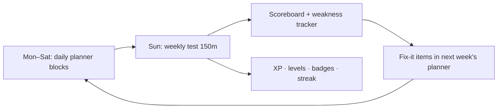

# 🚀 START HERE — Your 26-Week Career Upgrade (26 Oct 2026 → 25 Apr 2027)

> **Who this is for:** a Java developer (3 yrs, Spring Boot + SQL at work) rebuilding Core Java and DSA, and adding
> System Design, Azure and AI Engineering — to switch to a strong **Java Backend + Cloud + AI Engineer** role.
> **Time:** Mon–Fri 3.5 h · Sat 4.5 h · Sun 3.5 h (test) ≈ **25.5 h/week** · average 3.6 h/day.

---

## 🏁 Where you'll be in Week 26
| Track | Definition of done |
|---|---|
| ☕ **Java Backend** | Core Java (OOP → collections internals → streams → concurrency → JVM/GC) + Spring Boot internals, JPA, transactions, security, testing, microservices, Kafka, Docker, Kubernetes, CI/CD — proven by **TicketVerse**, a deployed microservices platform with an AI assistant |
| 🧩 **DSA** | 325 core (+118 bonus) LeetCode problems across 20+ patterns in Java; Mediums in 20–25 min; spaced-revision system |
| 🏗️ **System Design** | SOLID + GoF patterns, ~18 machine-coding problems coded in Java (LLD), ~20 HLD case studies, timed mocks |
| ☁️ **Azure** | **AZ-900 → AZ-104 → AI-200** certified + migration lab + TicketVerse deployed on Azure |
| 🤖 **AI Engineering** | Python + LLMs, RAG, evals, agents (LangGraph), MCP, guardrails, LLMOps, fine-tuning, Spring AI, Microsoft Foundry — 6 portfolio projects + AI features in TicketVerse |
| 💼 **Career** | Resume, LinkedIn/Naukri, STAR stories, mock interviews; applying from Week 20 |

> ⚠️ **Important correction:** the path you were told (AZ-900 → AZ-104 → **AZ-204**) is outdated — **AZ-204 was retired on
> 31 Jul 2026** and replaced by **AI-200** (Azure AI Cloud Developer Associate). Details: [Azure Cloud/README.md](Azure%20Cloud/README.md).

---

## 🗂️ Your folders
| Folder | What's inside |
|---|---|
| [01_Daily_Planner/](01_Daily_Planner/) | ⭐ **Open this every day.** One file per week with every day's checklist across all tracks |
| [01_MASTER_CALENDAR.md](01_MASTER_CALENDAR.md) | All 26 weeks × 5 tracks on one page, with dates, bosses, exams |
| [02_GAP_ANALYSIS_What_You_Were_Missing.md](02_GAP_ANALYSIS_What_You_Were_Missing.md) | Skills you didn't list but the market expects — and where they're covered |
| [03_SETUP_YOUR_LAPTOP.md](03_SETUP_YOUR_LAPTOP.md) | ⚙️ **Do this first:** company-laptop setup (tested), accounts, tool requests, Artifactory, Azure accounts, message templates · *local only — not in the GitHub backup* |
| [00_Progress_Tracker/](00_Progress_Tracker/) | 🧠 AI memory, dashboard, daily log, weekly tests, weaknesses — **so no session starts from zero** |
| [Java + Spring + … + Kubernetes/](Java%20%2B%20Spring%20%2B%20Microservices%20%2B%20Kafka%20%2B%20Docker%20%2B%20Kubernetes/) | Java track: README, roadmap, 26 week files, TicketVerse project spec, interview question bank |
| [DSA/](DSA/) | Pattern roadmap, 26 week files with exact LeetCode links, tested Java templates, revision tracker |
| [System Design/](System%20Design/) | LLD + HLD roadmap, 26 week files, interview frameworks |
| [Azure Cloud/](Azure%20Cloud/) | Cert guide (AZ-900, AZ-104, AI-200), 26 week files with labs, cost-safety guide |
| [AI Engineering/](AI%20Engineering/) | AI roadmap, 26 week files, project specs, AI interview question bank |
| [Career & Interview Prep/](Career%20%26%20Interview%20Prep/) | Resume, LinkedIn, STAR stories, application tracker, negotiation |

Each folder also has a **PDF** copy for reading/printing. Markdown files are the working copies (checkboxes, progress).

---

## ⏰ Your fixed daily template
| Day | Block A (60m) | Block B (60m) | Block C (45m) | Block D (45m) | Block E |
|---|---|---|---|---|---|
| **Mon** | 🧩 DSA | ☕ Java | 🤖 AI | 🏗️ System Design | — |
| **Tue** | 🧩 DSA | ☕ Java | ☁️ Azure | 🤖 AI | — |
| **Wed** | 🧩 DSA | ☕ Java | 🏗️ System Design | ☁️ Azure | — |
| **Thu** | 🧩 DSA | ☕ Java | 🤖 AI | 🏗️ System Design | — |
| **Fri** | 🧩 DSA | ☕ Java | ☁️ Azure | 🤖 AI | — |
| **Sat** | 🧩 DSA | ☕ Java BUILD | 🤖 AI BUILD (45m) | 🏗️ SD practice (45m) | ☁️ Azure LAB (60m) |
| **Sun** | 📝 **Weekly test (150m)** | 🔍 Retro (30m) | 👀 Preview & revise (30m) | | |

- Take a 5-minute break between blocks. Do DSA **first** (fresh brain). Blocks C/D may be swapped or merged into one 90-min block for labs.
- Saturday's 3rd DSA problem is a 🔥 **weekend challenge** (often a Hard) — finish it in Sunday's preview slot if Saturday runs out.
- **Minimum viable day** (sick/tired/office crunch): 1 DSA problem + 30 min Java → streak survives. **Never miss two days in a row.**

---

## 🔄 How to use the system
1. **Each morning/evening:** open `01_Daily_Planner/Week-XX.md` → do today's blocks top to bottom → tick `[x]`.
2. Need details? Each block links to the track's week file (what to learn, exact resources, the hands-on task, "done when").
3. **Work with your AI mentor** (GitHub Copilot) — start every new chat with the **magic prompt**:
   ```text
   Read C:\Users\rkumar48\Personal_Learning\00_Progress_Tracker\AI_MEMORY.md and follow its "Session start protocol".
   Then tell me where I am, my streak/XP, and today's tasks.
   ```
   Then use the commands below (a new chat each day is fine — the mentor remembers everything through these files).
4. **Sunday:** paste `Read 00_Progress_Tracker\AI_MEMORY.md and WEEKLY_TEST_PROTOCOL.md. Run my Week N test now.`
   The mentor tests all 5 tracks, saves the test, updates the scoreboard & weakness tracker, and inserts **Fix-it items** into next week.
5. Behind schedule? Don't panic — follow the catch-up rules in Section 7 of `AI_MEMORY.md`.

### 💬 Mentor commands (type them in the chat)
| Type | When | What happens |
|---|---|---|
| magic prompt (or `start`) | first message of a new chat | where you are · streak/XP · today's blocks · fix-its · reminders |
| `doubt: …` | any time | plain explanation + example; doubts that keep coming back become fix-it items |
| `teach: <topic>` | before or after a block | 10-minute lesson + 3 check questions |
| `hint: <problem>` | stuck on a DSA problem | hints step by step (pattern → approach → pseudo-code); `solution:` for the full answer — then mark it 🟡/🔴 in the revision tracker |
| `review: <repo or file>` | after a coding task | senior-level code review |
| `quiz: <topic>` | any time | 5 quick questions, scored |
| `log today: …` | end of the day | ticks your planner, writes the daily log, XP and streak |
| `test week <N>` | Sunday | the full weekly test (all 5 tracks) |
| `status` · `remind` | any time | dashboard summary · upcoming installs, IT requests and exams |
| `behind` · `lite day` | missed days · tired or busy | catch-up plan · minimum viable day |
| `wrap up` | before closing a chat | saves a handoff note so the next chat continues |



---

## 🎮 Make it a game (because consistency beats intensity)
- **6 Seasons**, each ending with a **⚔️ Boss Battle** (W4, W9, W14, W19, W23, W26): timed integrated challenges; beat the boss (≥ 70 overall, no section < 50) for **+300 XP** and a badge.
- **XP:** +10 per completed block · LeetCode +5/+10/+20 (E/M/H) · weekly test = your % · cert +500 · project milestone +200 · 7-day streak +50.
- **Levels:** Trainee → Code Cadet (500) → Junior Dev (1,500) → SDE-1 (3,000) → SDE-2 (5,000) → Senior SDE (7,500) → Staff Engineer (10,000) → **Principal Architect (13,000)**.
- **Badges:** First Blood, Century, Cloud Cadet, RAG Ranger, Agent Smith, MCP Maker, Kube Commander, Race-Condition Slayer, Boss Slayer ×6 … (full list in the dashboard).
- **One evolving product:** everything you learn in Java, Azure and AI lands in **TicketVerse** — so every week visibly upgrades your portfolio.

| Season | Weeks | Boss week | Season reward |
|---|---|---|---|
| 1 · Foundation Forge | W1–W4 | W4 | Java OOP solid · AZ-900 ready · first AI app (TerminalGPT) |
| 2 · Concurrency Crucible | W5–W9 | W9 | Concurrency mastered · **AZ-900 passed** · RAG + evals |
| 3 · Spring Citadel | W10–W14 | W14 | **TicketVerse v1.0** · CareerPilot agent · AZ-104 half done |
| 4 · Distributed Kingdom | W15–W19 | W19 | Microservices + Kafka saga in Docker · **AZ-104 passed** · MCP + guardrails |
| 5 · Cloud Ascension | W20–W23 | W23 | Kubernetes + CI/CD + **TicketVerse live on Azure** · Spring AI |
| 6 · Final Boss: The Offer | W24–W26 | W26 | AI assistant shipped · **AI-200 passed** · interview-ready |

---

## 🎓 Exam anchors
| Exam | Week | Window |
|---|---|---|
| AZ-900 Azure Fundamentals | W5 | 23–29 Nov 2026 |
| AZ-104 Azure Administrator | W16 | 8–14 Feb 2027 |
| AI-200 Azure AI Cloud Developer | W26 | 19–25 Apr 2027 |

---

## ✅ Setup — follow [03_SETUP_YOUR_LAPTOP.md](03_SETUP_YOUR_LAPTOP.md) (Sat 24 – Sun 25 Oct)
Decided on 24 Oct 2026, based on tests run on your laptop:
- **Company laptop = main machine** for DSA, Java, System Design, Azure, Python basics and mentor chats.
- **Personal laptop (browser → GitHub Codespaces/Colab)** for AI coding from Week 4 — the free AI APIs are blocked on the company
  network — and for everything job-search related.
- Code lives in your **personal GitHub** (personal email), never the company GitLab. Certifications go on a **personal Microsoft account**.
- Installs only via the Company Portal / JFrog Artifactory; never bypass a block. Java: **Amazon Corretto 25** for learning projects
  (work stays on JDK 11); Python: **3.12 + pip + uv through JFrog**; still to do: ask IT for **Docker/Rancher + WSL2**.
- Done 24 Oct: accounts, tools, Git identity + push test, pip/uv through JFrog, Corretto 25, private plan backup (`learning-plan`).

The guide has the step-by-step checklist, Artifactory pip setup, "No uv?" command equivalents, the Azure account decision,
a glossary of every tool, and message templates for your team, manager and L&D.

---

## 🧱 House rules
1. **Write code every day.** Your known gap is *writing* complex code — reading is not enough.
2. **Sunday test is non-negotiable** (mini version allowed). It's how weak spots get fixed instead of piling up.
3. **One resource per topic.** Finish it; don't collect playlists.
4. **Log daily** (2 minutes) — the AI can only help with what's written down.
5. **Ship weekly:** every Saturday ends with a commit/demo.
