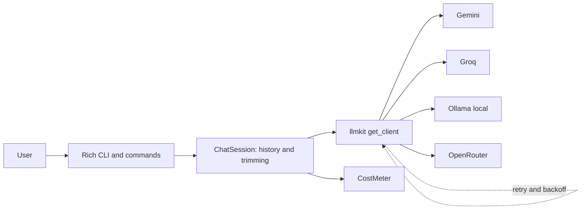
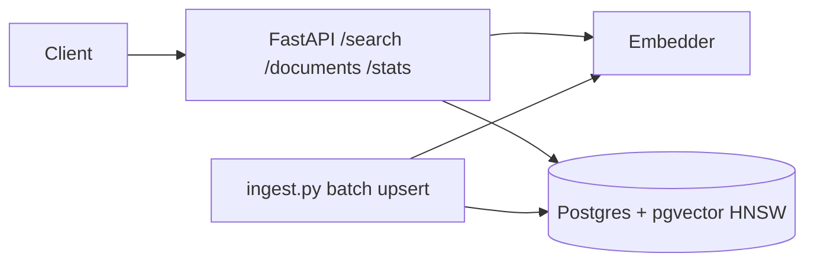
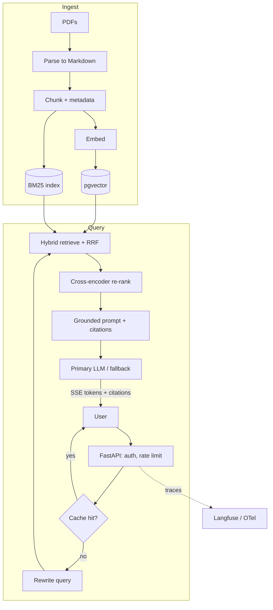
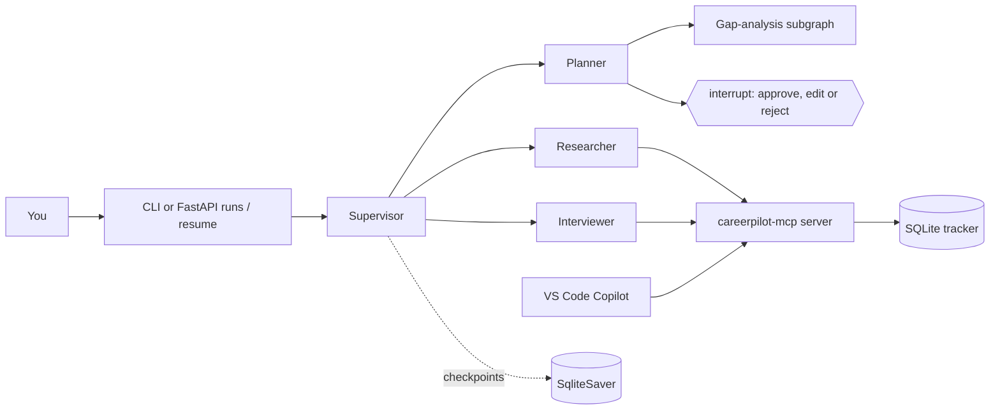
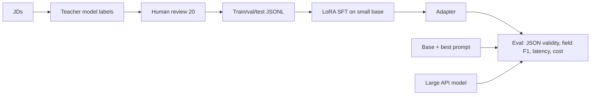
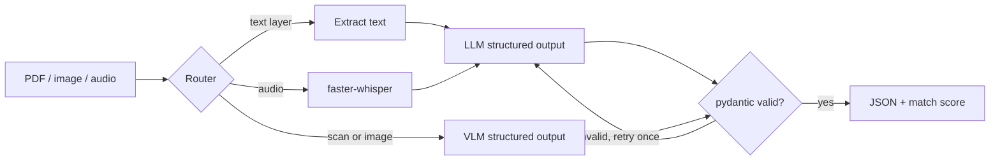
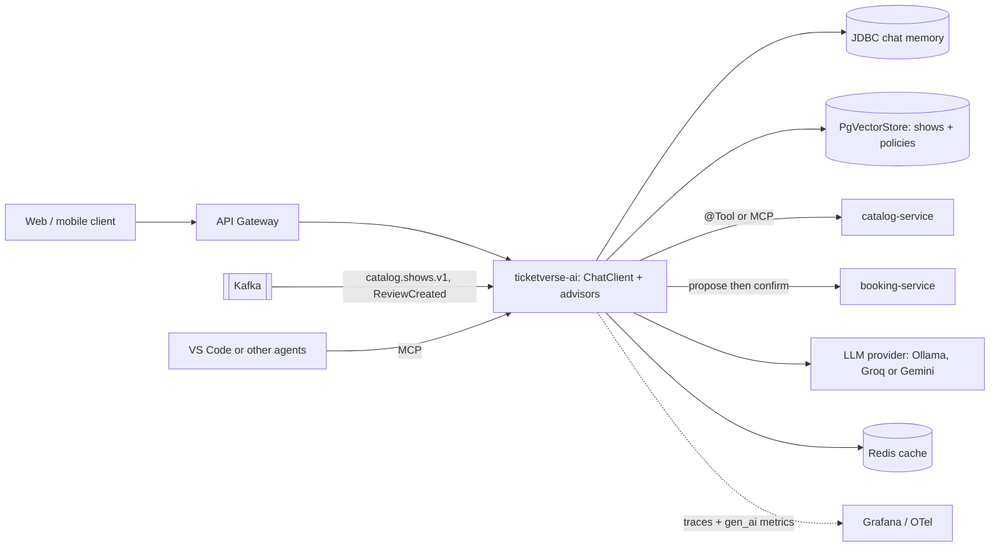

# 🛠️ AI Engineering — Project Specs

Seven portfolio projects, each shipped on a Saturday and improved over later weeks of the 30-week plan. Every project needs: README (problem → demo → architecture → metrics → run in 3 commands), tests, a Git tag, and numbers you can quote in interviews.

| # | Project | Weeks | Location | Final tag | Core skills |
|---|---|---|---|---|---|
| 1 | **TerminalGPT** | W6 | `ai-engineering-lab/05-terminalgpt` + `llmkit/` | `v1.0-terminalgpt` | LLM APIs, streaming, memory, retries, fallback, cost |
| 2 | **SemanticSearch API** | W9 (Boss) | `08-semantic-search-api` | `v1.0-semantic-search` | Embeddings, pgvector/HNSW, FastAPI |
| 3 | **DocuMind** (RAG) | W10–W13, W19, W25 (Boss), W29 | `09-documind` | `v3.1-documind` | RAG, hybrid + re-rank, evals, production API, LLMOps, Azure, agentic RAG |
| 4 | **CareerPilot** (agents + MCP) | W7, W14–W18 (W15 Boss), W25, W29 | `06-jd-parser`, `10-careerpilot` | `v1.1-careerpilot-secure` | Structured output, agents, LangGraph, MCP, security |
| 5 | **FineTune Lab** | W21 | `12-finetune-lab` | `v1.0-finetune-lab` | Dataset prep, LoRA/QLoRA, evaluation |
| 6 | **Resume/JD Extractor** | W22 | `13-resume-jd-extractor` | `v1.0-resume-jd-extractor` | VLMs, PDF/OCR, speech, schema validation |
| 7 | **TicketVerse AI** | W23–W24, W27–W28 | `ticketverse/ticketverse-ai` | `ticketverse-v2.0-ai` | Spring AI 2.0, tools, RAG, MCP, evals, observability, Azure launch |

**Smaller builds that feed the projects (not counted above):** `02-python-data` (W3) · `03-ml-basics` spam classifier (W4 Boss, tag `v1.0-spam-boss`) and the LLM-vs-classifier comparison (W7) · `04-llm-playground` notebooks (W5) · `07-backend-foundations` Docker + SQL + FastAPI stack (W8) · `11-oss-inference` local-vs-API benchmark (W20 Boss, tag `v1.0-local-bench`) · `14-ai-system-design` (W26).

**Common definition of done (all projects):** keys only in Codespaces secrets / env vars · `uv run pytest` (or `./mvnw verify`) green · README with diagram + metrics table · tag pushed · 3-line "what I learned" in `learning-log.md`.

---

## 1. TerminalGPT — provider-agnostic CLI chatbot (W6)

**Problem.** Before building RAG or agents you must master the raw API: roles, statelessness, streaming, tokens, cost, rate limits and secrets — across *free* providers. This is also your first week in GitHub Codespaces.

| Version | Week | Features |
|---|---|---|
| v0.1 | W6 Tue | Streaming chat loop, message history, `/reset`, `/system`, history trimming |
| v1.0 | W6 Sat | `/model <provider>` hot switch (Gemini, Groq, Ollama, OpenRouter), live token + cost meter, tenacity retries on 429/5xx/timeouts, provider fallback, `/save` transcript (JSON), Rich UI |
| v1.1 (stretch) | — | `/compare` sends one prompt to two providers concurrently and shows latency + cost |

**Tech stack.** Python 3.13 in a Codespaces devcontainer · uv · `openai` SDK (OpenAI-compatible endpoints) · pydantic-settings · tenacity · tiktoken · Rich · pytest. The provider layer is extracted as **`llmkit/`** (settings, clients, cost meter, retries, `chat_with_fallback`) and reused by every later Python project.

**Acceptance criteria**
- Tokens stream visibly; a 5-turn conversation remembers context; `/reset` clears it.
- Provider switch works mid-session without restart; one config change adds a provider; a 429 from one provider falls back to the next.
- 429/timeout/bad URL produce a friendly message (no stack trace) after bounded retries.
- No key in any file (Codespaces secrets); no keys in logs or transcripts.
- ≥ 8 offline tests using a fake client.

**Evaluation requirements**
- Self-score ≥ 80/100 on the W6 Saturday rubric (streaming 25, memory 25, provider switch 20, cost meter 20, error handling 10).
- Token count within ±10% of provider-reported usage (when the provider returns usage); time-to-first-token logged per provider.

**Stretch ideas.** `/compare` mode · `/file <path>` to chat with a local text file · voice input using your W22 Whisper code.

**Resume bullet you earn.** *Built a provider-agnostic Python CLI chatbot (Gemini, Groq, Ollama, OpenRouter) with streaming, conversation memory, retry/backoff and a live token-cost meter; extracted the provider layer into a reusable library used across six later AI projects.*

---

## 2. SemanticSearch API — FastAPI + pgvector (W9 Boss)

**Problem.** Keyword search misses meaning ("remote Java role with Kafka" ≠ exact words). Build semantic search over job postings or movie plots — the timed boss battle that closes Season 2, after you learned Docker, SQL and FastAPI basics in W8.

| Version | Week | Features |
|---|---|---|
| v0.1 | W9 Mon–Fri | CPU-only embedding setup, pgvector in Docker with an HNSW index, idempotent ingest (2–5k rows), `labels.json` with 10 labelled queries, router skeleton |
| v1.0 | W9 Sat (Boss, 45 min) | `GET /search` with `k` + metadata filters and scores, `POST /documents`, `/stats`, recall@10, p95 latency logging, 3 tests, README |
| v1.1 (stretch) | — | Same queries on Qdrant; hybrid BM25; multilingual model for Hindi queries; KMeans clusters over the embeddings |

**Tech stack.** FastAPI (`fastapi[standard]`) · sentence-transformers (`all-MiniLM-L6-v2`, 384-d; PyTorch from the CPU-only index) or Ollama `nomic-embed-text` (768-d) · PostgreSQL 18 + pgvector 0.8.7 (`pgvector/pgvector:0.8.7-pg18`) · psycopg 3 + pgvector-python · pytest.

**Acceptance criteria**
- `docker run` brings up pgvector; `ingest.py` is idempotent (re-run → same row count).
- `/search` supports `q`, `k`, and at least two metadata filters; responses include scores.
- `/docs` shows typed request/response models; ≥ 3 API tests with `TestClient`.
- README: curl examples, Mermaid diagram, dataset source and licence.

**Evaluation requirements**
- Boss rubric ≥ 80/100 and recall@10 ≥ 0.80 on 10 hand-labelled queries.
- p95 search latency < 300 ms locally on ≤ 5k rows (after model warm-up); `EXPLAIN ANALYZE` shows the HNSW index plan (on small tables use `SET LOCAL enable_seqscan = off` inside a transaction to see it).

**Stretch ideas.** Qdrant comparison table · hybrid search · "more like this" endpoint · pagination with cursor.

**Resume bullet you earn.** *Built a semantic search API (FastAPI + PostgreSQL/pgvector HNSW) over 5k documents with metadata filtering; reached recall@10 of 0.8+ on a labelled query set at sub-300 ms p95.*

---

## 3. DocuMind — production RAG over your PDFs (W10–W13, W19, W25 Boss, W29)

**Problem.** Teams need answers from their documents with **citations**, honest refusals, measurable quality, and production behaviour (streaming, auth, cost control).

| Version | Week | Features |
|---|---|---|
| v0.1 | W10 | PDF → Markdown with page markers, 2 chunkers, pgvector retrieval, grounded prompt with `[doc:page]` citations, refusal threshold, CLI + `POST /ask`; LangChain 1.x re-implementation for comparison |
| v1.0 | W11 | BM25 + vector hybrid with RRF, cross-encoder re-rank, query rewrite / multi-query experiments, parent-child context, metadata filters, debug mode |
| eval | W12 | Golden set (15 items in session, 30 with the stretch), retrieval metrics (recall@k, MRR, nDCG), RAGAS/DeepEval generation metrics with judge calibration, Langfuse traces, timed `EVAL_REPORT.md` (tag `eval-report-w12`) |
| v2.0 | W13 | Modular FastAPI, SSE streaming (async generators), API-key auth, per-key rate limiting, Redis exact + semantic cache, multi-stage Docker image, Docker Compose |
| llmops | W19 | OpenTelemetry + Langfuse dashboards, prompt versions with labels, CI eval gate on PRs (pgvector service container), 2-tier model cascade, feedback capture, **public demo on a Hugging Face Docker Space** |
| benchmark | W20 (Boss) | Local vs API models on 10 golden questions (`11-oss-inference/BENCHMARK.md`) |
| v3.0-azure | W25 (Boss) | Container Apps with a system-assigned managed identity calling a Microsoft Foundry model keylessly, Azure AI Search retriever (hybrid + semantic ranker), deploy/teardown scripts, `AZURE_ARCHITECTURE.md` |
| v3.1 | W29 | Agentic (corrective) RAG and multi-hop query decomposition in LangGraph behind a `retriever_mode` flag, both modes measured in CI |

**Tech stack.** Python · pymupdf4llm/Docling · pgvector · rank_bm25 or Postgres FTS · sentence-transformers CrossEncoder · LangChain 1.x (comparison) / LangGraph (agentic RAG) · FastAPI (SSE) · Redis 8 + RedisVL · Langfuse · RAGAS/DeepEval · OpenTelemetry · Docker Compose · GitHub Actions · Hugging Face Spaces · Azure (Container Apps, Foundry, AI Search).

**Acceptance criteria**
- Every answer has citations that point to real chunks/pages, or an explicit "I don't know".
- `docker compose up` on a clean clone runs api + pgvector + redis; ingest → ask → stream works.
- Missing API key → 401; over limit → 429; a slow provider ends the stream with an `error` event (25 s timeout); provider fallback comes from `llmkit`.
- Eval scripts are unit-tested; results reproducible from `evals/golden.jsonl`.
- W25: nothing left running after `teardown.sh`; no API key stored anywhere (managed identity).

**Evaluation requirements (30-item golden set: ≥ 3 unanswerable, ≥ 5 multi-hop)**

| Metric | Threshold |
|---|---|
| Retrieval recall@5 | ≥ 0.80 (v1) |
| MRR | ≥ 0.65 |
| Faithfulness (RAGAS/DeepEval) | ≥ 0.85 |
| Answer/response relevancy | ≥ 0.80 |
| Correct refusals on unanswerable questions | ≥ 0.80 |
| Citation validity (cited chunk exists and supports claim, spot-checked) | 100% |
| Judge–human agreement on 10 items | ≥ 80% (else fix the judge prompt) |
| Latency (free tier) | time-to-first-token ≤ 2 s, p95 full answer ≤ 6 s |
| CI gate | PR fails if recall@5 drops > 0.05 or attack block rate < 90% |
| Agentic mode (v3.1) | beats v1 on the 10 hardest questions, never more than 2 query rewrites |

**Stretch ideas.** Contextual retrieval prefixes · RAPTOR-style summaries · Hindi + English queries with a multilingual embedder · GraphRAG experiment for "global" questions · nightly full-golden-set workflow + `LLMOPS.md`.

**Resume bullet you earn.** *Built and productionised a RAG service (FastAPI, pgvector, BM25 + vector hybrid with RRF, cross-encoder re-ranking, agentic retrieval) with SSE streaming, Redis semantic caching, CI eval gates and a keyless Azure Container Apps deployment; improved recall@5 from X to Y while holding faithfulness ≥ 0.85 on a 30-question golden set.*

---

## 4. CareerPilot — multi-agent job-hunt assistant + MCP server (W7, W14–W18, W25, W29)

**Problem.** Job hunting is repetitive: read JDs, find gaps, plan prep, track applications, practise interviews. CareerPilot automates the boring parts **with you in control** — and you will use it for your own switch.

| Version | Week | Features |
|---|---|---|
| v0.0 JD Parser | W7 | `parse(jd) -> JobPosting` (structured output + retry), results in `postings.jsonl` (loaded into Postgres in W8), `match(jd, my_skills.yaml)` |
| v0.1-scratch | W14 | From-scratch tool loop (no framework), 3 tools incl. `save_application` (SQLite, using your W8 SQL), memory (window + summary + profile), JSONL traces, 8 scenario tests |
| v0.1 | W15 (Boss, 45 min) | LangGraph: typed state, ToolNode loop, SqliteSaver persistence, `interrupt()` plan approval, gap-analysis subgraph, 3 tests (FastAPI run/resume + Langfuse as stretch) |
| mcp v1.0 | W16 | `careerpilot-mcp` (Python SDK v2 `MCPServer`, in its own uv project): tools `add_application`, `update_status`, `list_applications`, `search_jobs`; resource `profile://me`; prompt `interview_prep`; stdio + Streamable HTTP; confirmations; 6+ in-memory client tests; used from VS Code |
| v1.0 | W17 | Supervisor + researcher (calls the MCP server through a small v2 `Client` → `StructuredTool` wrapper) + planner + interviewer (OpenAI Agents SDK; Pydantic AI as stretch; Agent Framework added W25); 10-scenario agent eval |
| v1.1-secure | W18–W19 | OWASP threat model, read/write tool split, approvals, step/token caps, PII redaction, 15+ case attack suite (25 with stretch), attack cases in the W19 CI gate |
| mcp auth | W29 | Streamable HTTP mode protected with bearer tokens (`TokenVerifier`), scope check on write tools, 3 HTTP tests |

**Tech stack.** Python · pydantic · SQLite · LangGraph 1.x (`StateGraph`, `ToolNode`, `SqliteSaver`, `interrupt`, subgraphs) · MCP Python SDK 2.x (`langchain-mcp-adapters` 0.3.x still requires `mcp<2`, hence the separate project + wrapper) · OpenAI Agents SDK / Pydantic AI / Microsoft Agent Framework (comparison) · Langfuse · Presidio · promptfoo · FastAPI (stretch).

**Acceptance criteria**
- JD Parser: field accuracy ≥ 85% on 6 hand-labelled JDs (10+ with the stretch).
- Plans are never saved without approval; reject → regenerate, edit → uses your text; state survives restarts.
- MCP server passes Inspector checks; destructive actions require confirmation; invalid inputs return clear errors; from W29 the HTTP mode rejects missing or under-scoped tokens.
- No tool can write without approval; each run has step and token caps; tool outputs are treated as untrusted data.

**Evaluation requirements**

| Metric | Threshold |
|---|---|
| Task success (10 scenarios) | ≥ 75% at W17, ≥ 80% after W18 |
| Tool-call accuracy (name + key args) | ≥ 90% |
| Average steps per task | ≤ 6 |
| Attack suite (≥ 15 cases: direct/indirect injection, PII exfiltration, excessive agency, unbounded consumption) | ≥ 90% blocked |
| Regression after hardening | task success drops ≤ 5 points |
| MCP tests | ≥ 6 in-memory `Client` tests (W16) + 3 HTTP auth tests (W29) |

**Stretch ideas.** Wrap a public jobs API as a second MCP server · expose an agent via A2A · resume tailoring with a diff view and approval · weekly report email (draft only, human sends) · text-to-SQL tool over the tracker with read-only credentials.

**Resume bullet you earn.** *Built a LangGraph multi-agent job-search assistant (researcher, planner, interviewer) with human-in-the-loop approvals, checkpointed state and an MCP server (Python SDK v2) usable from VS Code; evaluated on 12 scenarios (X% task success, Y% tool-call accuracy) and hardened against prompt injection with a 25-case attack suite (≥ 90% blocked) gated in CI.*

---

## 5. FineTune Lab — LoRA vs prompting for structured extraction (W21)

**Problem.** Can a small fine-tuned open model beat (or match) prompting for JD → JSON extraction at lower cost and latency? Prove it with data.

| Version | Week | Features |
|---|---|---|
| v0 | W21 Mon–Tue | `DECISION.md` (prompt vs RAG vs fine-tune), about 200 teacher-labelled examples, 20 human-reviewed, 80/10/10 split, `DATA.md` |
| v1.0 | W21 Thu–Sat | LoRA/QLoRA SFT on a ~1–4B instruct model (Unsloth/TRL) on free Colab/Kaggle GPU, loss plots, saved adapter, `REPORT.md` comparing base+prompt vs LoRA vs large API model |

**Tech stack.** Unsloth or TRL `SFTTrainer` · PEFT (LoRA/QLoRA) · Hugging Face Hub (private repo) · Colab T4 / Kaggle · pydantic validation · optional GGUF export → Ollama → `llmkit`.

**Acceptance criteria**
- No leakage: test examples never used in training or prompt examples (the split discipline from W4).
- Hyperparameters, GPU type, training time and seeds recorded; adapter reloads and reproduces the test scores.
- `REPORT.md` includes 5 error examples with analysis.

**Evaluation requirements**

| Metric | Threshold |
|---|---|
| JSON validity (fine-tuned) | ≥ 95% on the 20-item test split |
| Field-level F1 (defined in W4) | fine-tuned ≥ base+prompt + 10 points (or a clear explanation why not) |
| Latency + cost per 1,000 extractions | measured for all three options |

**Stretch ideas.** Grow to 400 examples and retrain · DPO on 100 preference pairs · serve the GGUF in Ollama and plug it into the JD Parser.

**Resume bullet you earn.** *Fine-tuned a small open-weight LLM with QLoRA (Unsloth/TRL) on about 200 distilled, human-reviewed examples for JD-to-JSON extraction; raised field-level F1 from X to Y versus prompting the same model and cut cost per 1,000 extractions by Z×.*

---

## 6. Resume/JD Multimodal Extractor (W22)

**Problem.** Real inputs are text PDFs, scanned PDFs, phone photos and voice notes. Produce reliable, schema-valid JSON and a resume–JD match score.

| Version | Week | Features |
|---|---|---|
| v0 | W22 Mon–Thu | VLM comparison (one image on local `qwen3-vl:2b`, the rest via Gemini), `extract_resume` with text-layer → VLM fallback, Whisper transcription → `TargetJob` JSON |
| skeleton | W22 Fri | `extract(path, kind)` router, pydantic `Resume`/`JobDescription`, validator with one repair retry, 6 test files with recorded responses (offline fixtures) |
| v1.0 | W22 Sat (timed build) | Routing + validation + `match(resume, jd)`, CLI `extract file.pdf --type resume`, all 6 test files passing offline |

**Tech stack.** PyMuPDF/pymupdf4llm, Docling or MarkItDown · Ollama VLM (`qwen3-vl:2b`) and/or Gemini free tier · faster-whisper · pydantic · Typer · pytest · Presidio for log redaction.

**Acceptance criteria**
- Routing decision logged per file; PII never written to logs in clear text (your W18 guardrails module).
- CLI: `extract file.pdf --type resume|jd`, `match resume.json jd.json`.
- 6 labelled test files (3 PDFs incl. one scan, 3 images) run offline from recorded responses (add them to your CI gate as a stretch) plus one live run.

**Evaluation requirements**

| Metric | Threshold |
|---|---|
| Schema validity (≤ 1 repair retry) | 100% |
| Field accuracy on labelled fields | ≥ 85% |
| Match score agrees with your manual judgement | ≥ 4 of 5 resume–JD pairs |
| Saturday self-score (timed build rubric) | ≥ 80/100 |

**Stretch ideas.** Compare with Azure Document Intelligence prebuilt layout · batch mode for 100 files with a review queue for low-confidence fields · Hinglish voice notes end-to-end.

**Resume bullet you earn.** *Built a multimodal document extractor that routes text PDFs, scans, images and voice notes to LLM/VLM structured-output pipelines with schema validation and repair retries, achieving 100% schema-valid JSON and X% field accuracy on mixed real-world inputs.*

---

## 7. TicketVerse AI — Spring AI inside the capstone (W23–W24, W27–W28)

**Problem.** TicketVerse (Java track capstone: AI-powered movie/event ticket booking) needs natural-language search, an assistant that answers policy questions and helps book **only with user confirmation**, and trustworthy review summaries — all inside a Java microservices system.

**Ownership.** The `ticketverse-ai` service is owned by the **AI track**. The Java track supplies the platform around it: catalog/review events (`catalog.shows.v1`, `ReviewCreated`) in Java W25, CI/CD in Java W26, platform hooks in Java W27 (gateway route + JWT relay, Kafka topics, Helm values, Resilience4j around AI calls, joint end-to-end test) and the Azure deployment in Java W28 (infrastructure from Azure W28). LLM calls run in Codespaces (2-core for the single service in W23–W24, 4-core for the full stack in W27–W28).

| Version | Week | Features |
|---|---|---|
| v0.1 | W23 | `ticketverse-ai` service: ChatClient endpoints, external prompt templates, streaming (`Flux<String>` as server-sent events), `.entity()` record mapping (`EventQuery`), JDBC chat memory, logging advisor, `local` (Ollama) / `cloud` (Groq; Gemini as stretch) profiles, Dockerfile, Compose entry |
| v0.2 | W24 | `@Tool` `searchShows` / `checkSeats`, PgVectorStore FAQ/policy RAG via ETL + `QuestionAnswerAdvisor`/`RetrievalAugmentationAdvisor`, MCP server + client (Streamable HTTP), `/ai/assistant/{conversationId}`, 10-case evaluation |
| v2.0-ai | W27 | Semantic show search with Kafka-synced embeddings (`catalog.shows.v1`), booking agent with server-issued confirmation token + idempotency key + relayed JWT, cited review summaries with Redis caching invalidated by `ReviewCreated`, 12-scenario eval + attack cases in the TicketVerse CI, joint end-to-end script with Java W27 |
| launch + demo | W28 | `azure` profile (model key from Key Vault, probes, degraded mode) handed to the Java W28 deployment, AI observability dashboard + SLOs, Locust latency/cost tuning, polished READMEs, live end-to-end check on Azure, recorded demo video |

**Tech stack.** Java 25 · Spring Boot 4.1.x · **Spring AI 2.0.x** (ChatClient, advisors, `@Tool`, PgVectorStore, ETL, RAG advisors, MCP server + client starters, JDBC chat memory, evaluators) · PostgreSQL + pgvector · Redis · Kafka · Resilience4j · Micrometer/OpenTelemetry + Grafana · Ollama (local) / Groq or Gemini (cloud; Azure OpenAI via the OpenAI module) · Docker Compose / Kubernetes (Gateway API, Helm) · Azure (Java W28 deployment).

**Acceptance criteria**
- The model can only **propose** a booking; `confirmBooking` requires a server-issued token from an explicit user action; repeated confirms never double-book (idempotency key).
- User identity always comes from the JWT relayed by the gateway, never from model output.
- `docker compose up` on a 4-core codespace (or the Kubernetes/Helm setup from the Java track) runs the full stack; an end-to-end script (search → ask → propose → confirm) passes on a fresh environment (W27) and against the live Azure URL (W28).
- Booking requests before W27 are politely refused with guidance; off-topic questions are refused.

**Evaluation requirements**

| Metric | Threshold |
|---|---|
| Semantic search nDCG@10 (10 labelled queries) | ≥ 0.70 |
| Assistant task success (12 scenarios) | ≥ 85% |
| Tool-call accuracy | ≥ 90% |
| Unconfirmed bookings | 0 (hard requirement) |
| Policy RAG cases (W24) | ≥ 8 / 10 |
| Review summaries: cited review IDs exist and support claims | 100% (spot-check) |
| Attack cases in CI (incl. malicious review text) | ≥ 90% blocked |
| After W28 tuning | p95 latency and cost/request improved with eval scores within 2% |

**Stretch ideas.** "Similar events" recommendations · LangChain4j AI Services comparison branch · Azure OpenAI (Foundry) with keyless auth · voice search · 20-scenario eval · LinkedIn post about the build.

**Resume bullet you earn.** *Integrated AI into a Spring Boot microservices ticketing platform using Spring AI 2.0: semantic event search (pgvector with Kafka-synced embeddings), a tool-calling booking assistant exposed over MCP with human confirmation and idempotent bookings, and cited review summaries; evaluated on 12 scenarios (X% task success, zero unconfirmed bookings), deployed on Azure with OpenTelemetry dashboards and CI attack tests.*
