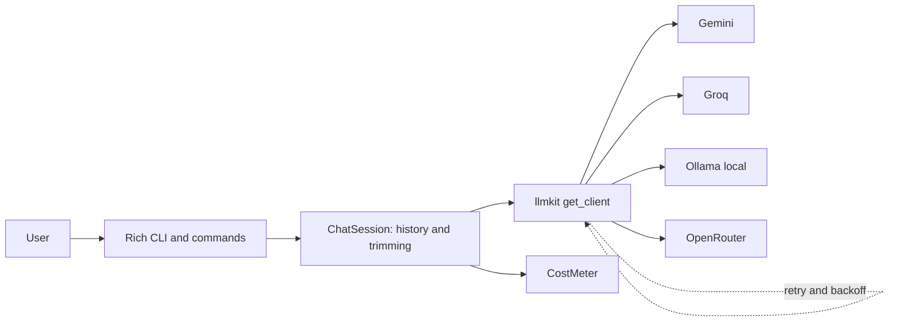
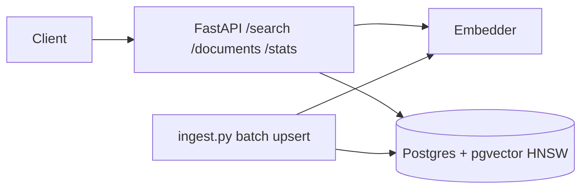
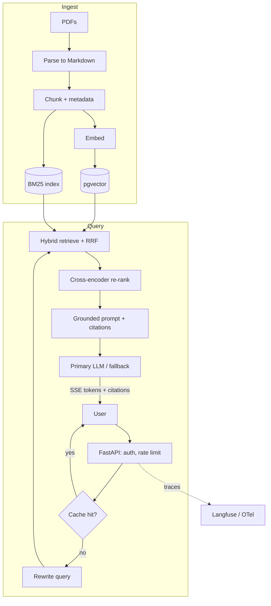
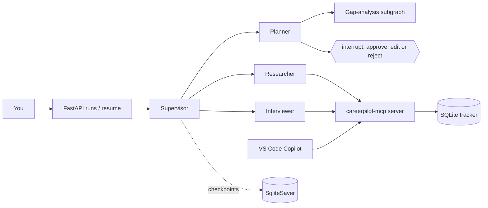
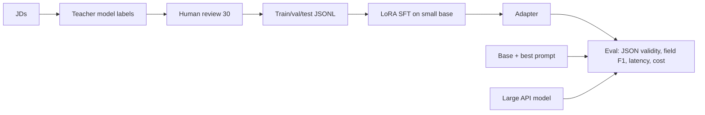
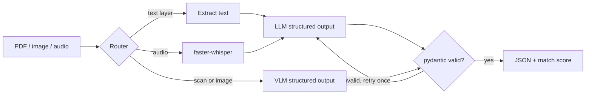
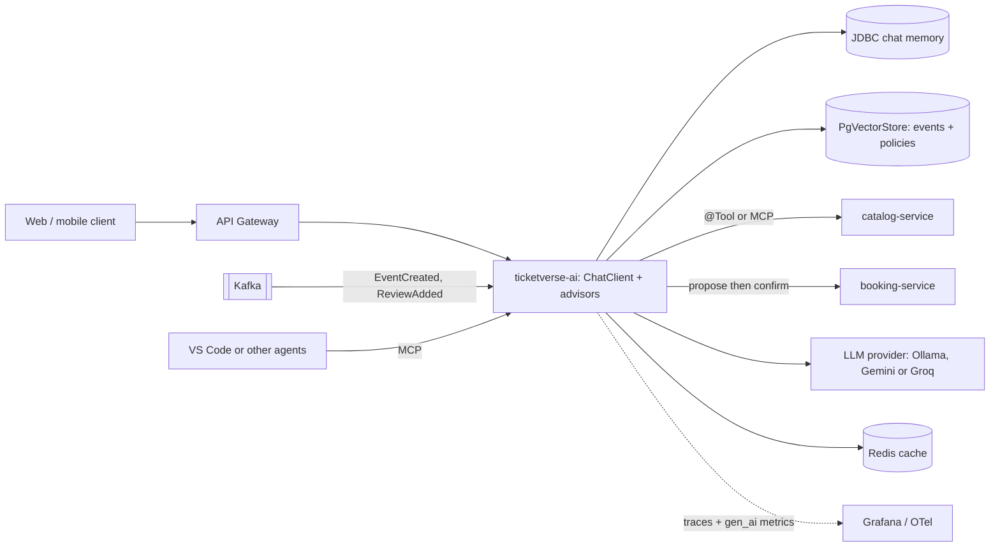

# 🛠️ AI Engineering — Project Specs

Seven portfolio projects, each shipped on a Saturday and improved over later weeks. Every project needs: README (problem → demo → architecture → metrics → run in 3 commands), tests, a Git tag, and numbers you can quote in interviews.

| # | Project | Weeks | Location | Final tag | Core skills |
|---|---|---|---|---|---|
| 1 | **TerminalGPT** | W4 (Boss) | `ai-engineering-lab/03-terminalgpt` + `llmkit/` | `v1.0-terminalgpt` | LLM APIs, streaming, memory, retries, cost |
| 2 | **SemanticSearch API** | W6 | `05-semantic-search-api` | `v1.0-semantic-search` | Embeddings, pgvector/HNSW, FastAPI |
| 3 | **DocuMind** (RAG) | W7–W10, W16–W17, W22 | `06-documind` | `v3.0-documind-azure` | RAG, hybrid + re-rank, evals, production API, LLMOps, Azure |
| 4 | **CareerPilot** (agents + MCP) | W5, W11–W16, W22, W26 | `04-jd-parser`, `07-careerpilot` | `v1.1-careerpilot-secure` | Structured output, agents, LangGraph, MCP, security |
| 5 | **FineTune Lab** | W18 | `09-finetune-lab` | `v1.0-finetune-lab` | Dataset prep, LoRA/QLoRA, evaluation |
| 6 | **Resume/JD Extractor** | W19 (Boss) | `10-resume-jd-extractor` | `v1.0-resume-jd-extractor` | VLMs, PDF/OCR, speech, schema validation |
| 7 | **TicketVerse AI** | W20–W25 | `ticketverse/ticketverse-ai` | `ticketverse-v2.0-ai` | Spring AI 2.0, tools, RAG, MCP, evals, observability |

**Common definition of done (all projects):** keys only in `.env`/env vars · `uv run pytest` (or `./mvnw verify`) green · README with diagram + metrics table · tag pushed · 3-line "what I learned" in `learning-log.md`.

---

## 1. TerminalGPT — provider-agnostic CLI chatbot (W4 Boss)

**Problem.** Before building RAG or agents you must master the raw API: roles, statelessness, streaming, tokens, cost, rate limits and secrets — across *free* providers.

| Version | Week | Features |
|---|---|---|
| v0.1 | W4 Tue | Streaming chat loop, message history, `/reset`, `/system`, history trimming |
| v1.0 | W4 Sat | `/model <provider>` hot switch (Gemini, Groq, Ollama, OpenRouter), live token + cost meter, tenacity retries on 429/5xx/timeouts, `/save` transcript (JSON), Rich UI |
| v1.1 (stretch) | — | `/compare` sends one prompt to two providers concurrently and shows latency + cost |

**Tech stack.** Python 3.13 · uv · `openai` SDK (OpenAI-compatible endpoints) · pydantic-settings + python-dotenv · tenacity · tiktoken · Rich · pytest. The provider layer is extracted as **`llmkit/`** and reused by every later Python project.

**Acceptance criteria**
- Tokens stream visibly; a 5-turn conversation remembers context; `/reset` clears it.
- Provider switch works mid-session without restart; one config change adds a provider.
- 429/timeout/bad URL produce a friendly message (no stack trace) after bounded retries.
- `.env` untracked; `.env.example` committed; no keys in logs or transcripts.
- ≥ 8 offline tests using a fake client.

**Evaluation requirements**
- Boss rubric ≥ 80/100 (streaming 25, memory 25, provider switch 20, cost meter 20, error handling 10).
- Token count within ±10% of provider-reported usage (when the provider returns usage); time-to-first-token logged per provider.

**Stretch ideas.** `/compare` mode · `/file <path>` to chat with a local text file · voice input using W19 Whisper code.

**Resume bullet you earn.** *Built a provider-agnostic Python CLI chatbot (Gemini, Groq, Ollama, OpenRouter) with streaming, conversation memory, retry/backoff and a live token-cost meter; extracted the provider layer into a reusable library used across six later AI projects.*

---

## 2. SemanticSearch API — FastAPI + pgvector (W6)

**Problem.** Keyword search misses meaning ("remote Java role with Kafka" ≠ exact words). Build semantic search over job postings or movie plots.

| Version | Week | Features |
|---|---|---|
| v0.1 | W6 Thu | FastAPI skeleton: `/health`, `/embed`, stub `/search`, model injected via `Depends` |
| v1.0 | W6 Sat | Idempotent ingest (2–5k rows), HNSW cosine index, `GET /search` with `k` + metadata filters, `POST /documents`, `/stats`, latency logging, labelled eval |
| v1.1 (stretch) | — | Same queries on Qdrant; hybrid BM25; multilingual model for Hindi queries |

**Tech stack.** FastAPI (`fastapi[standard]`) · sentence-transformers (`all-MiniLM-L6-v2`, 384-d) or Ollama `nomic-embed-text` (768-d) · PostgreSQL 18 + pgvector 0.8.7 (`pgvector/pgvector:0.8.7-pg18`) · psycopg 3 + pgvector-python · pytest.

**Acceptance criteria**
- `docker run` brings up pgvector; `ingest.py` is idempotent (re-run → same row count).
- `/search` supports `q`, `k`, and at least two metadata filters; responses include scores.
- `/docs` shows typed request/response models; ≥ 3 API tests with `TestClient`.
- README: curl examples, Mermaid diagram, dataset source and licence.

**Evaluation requirements**
- recall@10 ≥ 0.80 on 15 hand-labelled queries.
- p95 search latency < 300 ms locally on ≤ 5k rows (after model warm-up); `EXPLAIN ANALYZE` proves the HNSW index is used.

**Stretch ideas.** Qdrant comparison table · hybrid search · "more like this" endpoint · pagination with cursor.

**Resume bullet you earn.** *Built a semantic search API (FastAPI + PostgreSQL/pgvector HNSW) over 5k documents with metadata filtering; reached recall@10 of 0.8+ on a labelled query set at sub-300 ms p95.*

---

## 3. DocuMind — production RAG over your PDFs (W7–W10, W16–W17, W22)

**Problem.** Teams need answers from their documents with **citations**, honest refusals, measurable quality, and production behaviour (streaming, auth, cost control).

| Version | Week | Features |
|---|---|---|
| v0.1 | W7 | PDF → Markdown with page markers, 2 chunkers, pgvector retrieval, grounded prompt with `[doc:page]` citations, refusal threshold, CLI + `POST /ask`; LangChain 1.x re-implementation for comparison |
| v1.0 | W8 | BM25 + vector hybrid with RRF, cross-encoder re-rank, query rewrite / multi-query / HyDE experiments, parent-child context, metadata filters, debug mode |
| eval | W9 (Boss) | 30-item golden set, retrieval metrics (recall@k, MRR, nDCG), RAGAS/DeepEval generation metrics with judge calibration, Langfuse traces, `EVAL_REPORT.md` |
| v2.0 | W10 | Modular FastAPI, SSE streaming, API-key auth, rate limiting, Redis exact + semantic cache, timeouts + provider fallback, background ingestion, OpenTelemetry, Docker Compose |
| llmops | W16–W17 | Prompt versions with labels, CI eval gate (PR) + nightly evals, 2-tier model cascade, feedback capture; local-model benchmark |
| v3.0-azure | W22 | Container Apps + Microsoft Foundry models via managed identity, Azure AI Search retriever (hybrid + semantic ranker), or a reviewed `AZURE_ARCHITECTURE.md` if no credits |

**Tech stack.** Python · pymupdf4llm/Docling · pgvector · rank_bm25 or Postgres FTS · sentence-transformers CrossEncoder · LangChain 1.x (comparison) · FastAPI (SSE) · Redis 8 + RedisVL · Langfuse · RAGAS/DeepEval · OpenTelemetry · Docker Compose · GitHub Actions · Azure (Container Apps, Foundry, AI Search, Managed Redis).

**Acceptance criteria**
- Every answer has citations that point to real chunks/pages, or an explicit "I don't know".
- `docker compose up` on a clean clone runs api + pgvector + redis; ingest → ask → stream works.
- Missing API key → 401; over limit → 429; provider failure → fallback within the 20 s timeout.
- Eval scripts are unit-tested; results reproducible from `evals/golden.jsonl`.

**Evaluation requirements (30-item golden set: ≥ 5 unanswerable, ≥ 5 multi-hop)**

| Metric | Threshold |
|---|---|
| Retrieval recall@5 | ≥ 0.80 (v1) |
| MRR | ≥ 0.65 |
| Faithfulness (RAGAS/DeepEval) | ≥ 0.85 |
| Answer/response relevancy | ≥ 0.80 |
| Correct refusals on unanswerable questions | ≥ 0.80 |
| Citation validity (cited chunk exists and supports claim, spot-checked) | 100% |
| Judge–human agreement on 15 items | ≥ 80% (else fix the judge prompt) |
| Latency (free tier) | time-to-first-token ≤ 2 s, p95 full answer ≤ 6 s |
| CI gate | PR fails if recall@5 drops > 0.05 or attack block rate < 90% |

**Stretch ideas.** Browser UI with `EventSource` · corrective RAG / RAPTOR · Hindi + English queries with a multilingual embedder · GraphRAG experiment for "global" questions.

**Resume bullet you earn.** *Built and productionised a RAG service (FastAPI, pgvector, BM25 + vector hybrid with RRF, cross-encoder re-ranking) with SSE streaming, Redis semantic caching, provider fallback and CI eval gates; improved recall@5 from X to Y while holding faithfulness ≥ 0.85 on a 30-question golden set.*

---

## 4. CareerPilot — multi-agent job-hunt assistant + MCP server (W5, W11–W16)

**Problem.** Job hunting is repetitive: read JDs, find gaps, plan prep, track applications, practise interviews. CareerPilot automates the boring parts **with you in control** — and you will use it for your own switch.

| Version | Week | Features |
|---|---|---|
| v0.0 JD Parser | W5 | `parse(jd) -> JobPosting` (structured output + retry), SQLite store, `match(jd, my_skills.yaml)` |
| v0.1-scratch | W11 | From-scratch tool loop (no framework), 3 tools, memory (window + summary + profile), JSONL traces, 8 scenario tests |
| v0.1 | W12 | LangGraph: typed state, ToolNode loop, SqliteSaver persistence, `interrupt()` plan approval, gap-analysis subgraph, FastAPI run/resume, Langfuse |
| mcp v1.0 | W13 | `careerpilot-mcp` (Python SDK v2 `MCPServer`): tools `add_application`, `update_status`, `list_applications`, `search_jobs`; resource `profile://me`; prompt `interview_prep`; stdio + Streamable HTTP; confirmations; 8+ in-memory client tests; used from VS Code + LangGraph |
| v1.0 | W14 (Boss) | Supervisor + researcher + planner + interviewer; framework comparison (Agents SDK, Pydantic AI; Agent Framework added W22); 12-scenario agent eval |
| v1.1-secure | W15–W16 | OWASP threat model, read/write tool split, approvals, step/token caps, PII redaction, 25+ case attack suite, CI gate |

**Tech stack.** Python · pydantic · SQLite · LangGraph 1.x (`StateGraph`, `ToolNode`, `SqliteSaver`, `interrupt`, subgraphs) · MCP Python SDK 2.x · LangChain MCP adapters · OpenAI Agents SDK / Pydantic AI / Microsoft Agent Framework (comparison) · Langfuse · Presidio · promptfoo · FastAPI.

**Acceptance criteria**
- JD Parser: field accuracy ≥ 85% on 10 hand-labelled JDs.
- Plans are never saved without approval; reject → regenerate, edit → uses your text; state survives restarts.
- MCP server passes Inspector checks; destructive actions require confirmation; invalid inputs return clear errors.
- No tool can write without approval; each run has step and token caps; tool outputs are treated as untrusted data.

**Evaluation requirements**

| Metric | Threshold |
|---|---|
| Task success (12 scenarios) | ≥ 75% at W14, ≥ 80% after W16 |
| Tool-call accuracy (name + key args) | ≥ 90% |
| Average steps per task | ≤ 6 |
| Attack suite (≥ 25 cases: direct/indirect injection, PII exfiltration, excessive agency, unbounded consumption) | ≥ 90% blocked |
| Regression after hardening | task success drops ≤ 5 points |
| MCP tests | ≥ 8 passing (in-memory `Client`) |

**Stretch ideas.** Wrap a public jobs API as a second MCP server · expose an agent via A2A · resume tailoring with a diff view and approval · weekly report email (draft only, human sends).

**Resume bullet you earn.** *Built a LangGraph multi-agent job-search assistant (researcher, planner, interviewer) with human-in-the-loop approvals, checkpointed state and an MCP server (Python SDK v2) usable from VS Code; evaluated on 12 scenarios (X% task success, Y% tool-call accuracy) and hardened against prompt injection with a 25-case attack suite (≥ 90% blocked) gated in CI.*

---

## 5. FineTune Lab — LoRA vs prompting for structured extraction (W18)

**Problem.** Can a small fine-tuned open model beat (or match) prompting for JD → JSON extraction at lower cost and latency? Prove it with data.

| Version | Week | Features |
|---|---|---|
| v0 | W18 Mon–Tue | `DECISION.md` (prompt vs RAG vs fine-tune), 300–400 teacher-labelled examples, 30 human-reviewed, 80/10/10 split, `DATA.md` |
| v1.0 | W18 Thu–Sat | LoRA/QLoRA SFT on a ~1–4B instruct model (Unsloth/TRL) on free Colab/Kaggle GPU, loss plots, saved adapter, `REPORT.md` comparing base+prompt vs LoRA vs large API model |

**Tech stack.** Unsloth or TRL `SFTTrainer` · PEFT (LoRA/QLoRA) · Hugging Face Hub (private repo) · Colab T4 / Kaggle · pydantic validation · optional GGUF export → Ollama → `llmkit`.

**Acceptance criteria**
- No leakage: test examples never used in training or prompt examples.
- Hyperparameters, GPU type, training time and seeds recorded; adapter reloads and reproduces the test scores.
- `REPORT.md` includes 5 error examples with analysis.

**Evaluation requirements**

| Metric | Threshold |
|---|---|
| JSON validity (fine-tuned) | ≥ 98% on 40 test items |
| Field-level F1 | fine-tuned ≥ base+prompt + 10 points (or a clear explanation why not) |
| Latency + cost per 1,000 extractions | measured for all three options |

**Stretch ideas.** DPO on 100 preference pairs · distil from a larger teacher with 1,000+ examples · serve the GGUF in Ollama and plug it into the JD Parser.

**Resume bullet you earn.** *Fine-tuned a small open-weight LLM with QLoRA (Unsloth/TRL) on 400 distilled, human-reviewed examples for JD-to-JSON extraction; raised field-level F1 from X to Y versus prompting the same model and cut cost per 1,000 extractions by Z×.*

---

## 6. Resume/JD Multimodal Extractor (W19 Boss)

**Problem.** Real inputs are text PDFs, scanned PDFs, phone photos and voice notes. Produce reliable, schema-valid JSON and a resume–JD match score.

| Version | Week | Features |
|---|---|---|
| v0 | W19 Mon–Thu | VLM comparison (local Ollama vs API), `extract_resume` with text-layer → VLM fallback, Whisper transcription → `TargetJob` JSON |
| v1.0 | W19 Sat (Boss) | `extract(path, kind)` router, pydantic `Resume`/`JobDescription`, validation + one repair retry, `match(resume, jd)`, Typer CLI, 6 labelled test files |

**Tech stack.** PyMuPDF/pymupdf4llm, Docling or MarkItDown · Ollama VLM (e.g., `qwen3-vl`) and/or Gemini free tier · faster-whisper · pydantic · Typer · pytest · Presidio for log redaction.

**Acceptance criteria**
- Routing decision logged per file; PII never written to logs in clear text.
- CLI: `extract file.pdf --type resume|jd`, `match resume.json jd.json`.
- 6 labelled test files (3 PDFs incl. one scan, 3 images) run in CI without network (recorded responses) plus one live run.

**Evaluation requirements**

| Metric | Threshold |
|---|---|
| Schema validity (≤ 1 repair retry) | 100% |
| Field accuracy on labelled fields | ≥ 85% |
| Match score agrees with your manual judgement | ≥ 4 of 5 resume–JD pairs |
| Boss rubric | ≥ 80/100 |

**Stretch ideas.** Compare with Azure Document Intelligence prebuilt layout · batch mode for 100 files with a review queue for low-confidence fields · Hinglish voice notes end-to-end.

**Resume bullet you earn.** *Built a multimodal document extractor that routes text PDFs, scans, images and voice notes to LLM/VLM structured-output pipelines with schema validation and repair retries, achieving 100% schema-valid JSON and X% field accuracy on mixed real-world inputs.*

---

## 7. TicketVerse AI — Spring AI inside the capstone (W20–W25)

**Problem.** TicketVerse (Java track capstone: AI-powered movie/event ticket booking) needs natural-language search, an assistant that answers policy questions and helps book **only with user confirmation**, and trustworthy review summaries — all inside a Java microservices system.

| Version | Week | Features |
|---|---|---|
| v0.1 | W20 | `ticketverse-ai` service: ChatClient endpoints, external prompt templates, streaming, `.entity()` record mapping (`EventQuery`), JDBC chat memory, logging advisor, `local` (Ollama) / `cloud` (Gemini/Groq) profiles, Dockerfile, Compose entry |
| v0.2 | W21 | `@Tool` `searchShows` / `checkSeats`, PgVectorStore FAQ/policy RAG via ETL + `QuestionAnswerAdvisor`/`RetrievalAugmentationAdvisor`, MCP server (Streamable HTTP), `/ai/assistant/{conversationId}`, 15-case evaluation |
| v2.0-ai | W24 | Semantic event search with Kafka-synced embeddings, booking agent with server-issued confirmation token + idempotency key + JWT propagation, cited review summaries with Redis caching, 20-scenario eval + attack cases in CI |
| demo | W25 | Grafana/Langfuse AI dashboard + SLOs, load-tested latency/cost tuning, polished README, recorded demo video, LinkedIn post |

**Tech stack.** Java 25 · Spring Boot 4.1.x · **Spring AI 2.0.x** (ChatClient, advisors, `@Tool`, PgVectorStore, ETL, RAG advisors, MCP server starter, JDBC chat memory, evaluators) · PostgreSQL + pgvector · Redis · Kafka · Resilience4j · Micrometer/OpenTelemetry + Grafana · Ollama (local) / Gemini or Groq (cloud; Azure OpenAI via the OpenAI module) · Docker Compose / Kubernetes (Gateway API) · Azure (Java track W23).

**Acceptance criteria**
- The model can only **propose** a booking; `confirmBooking` requires a server-issued token from an explicit user action; repeated confirms never double-book (idempotency key).
- User identity always comes from the JWT/request context, never from model output.
- `docker compose up` (or the K8s manifests from the Java track) runs the full stack; an end-to-end script (search → ask → propose → confirm) passes on a fresh environment.
- Booking requests before W24 are politely refused with guidance; off-topic questions are refused.

**Evaluation requirements**

| Metric | Threshold |
|---|---|
| Semantic search nDCG@10 (15 labelled queries) | ≥ 0.70 |
| Assistant task success (20 scenarios) | ≥ 85% |
| Tool-call accuracy | ≥ 90% |
| Unconfirmed bookings | 0 (hard requirement) |
| Policy RAG cases (W21) | ≥ 12 / 15 |
| Review summaries: cited review IDs exist and support claims | 100% (spot-check) |
| Attack cases in CI (incl. malicious review text) | ≥ 90% blocked |
| After W25 tuning | p95 latency and cost/request improved with eval scores within 2% |

**Stretch ideas.** "Similar events" recommendations · LangChain4j AI Services comparison branch · Azure OpenAI (Foundry) with keyless auth · voice search.

**Resume bullet you earn.** *Integrated AI into a Spring Boot microservices ticketing platform using Spring AI 2.0: semantic event search (pgvector with Kafka-synced embeddings), a tool-calling booking assistant exposed over MCP with human confirmation and idempotent bookings, and cited review summaries; evaluated on 20 scenarios (X% task success, zero unconfirmed bookings) with OpenTelemetry dashboards and CI attack tests.*
