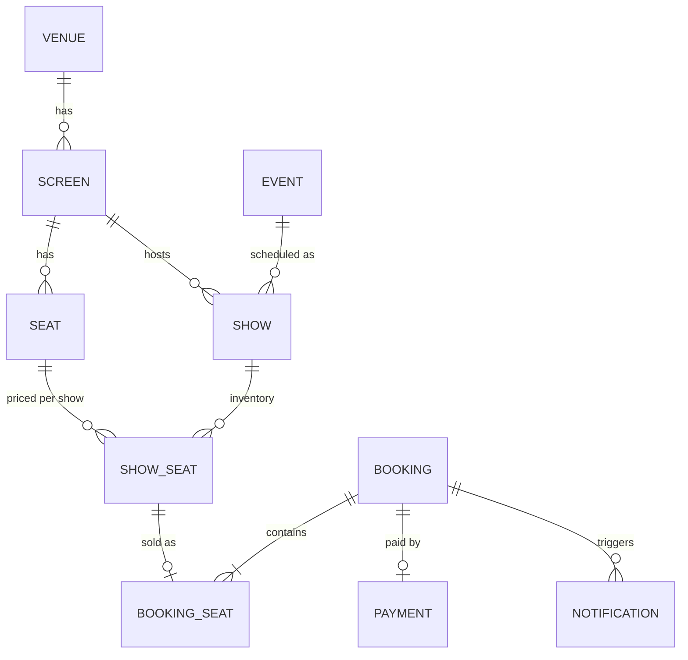
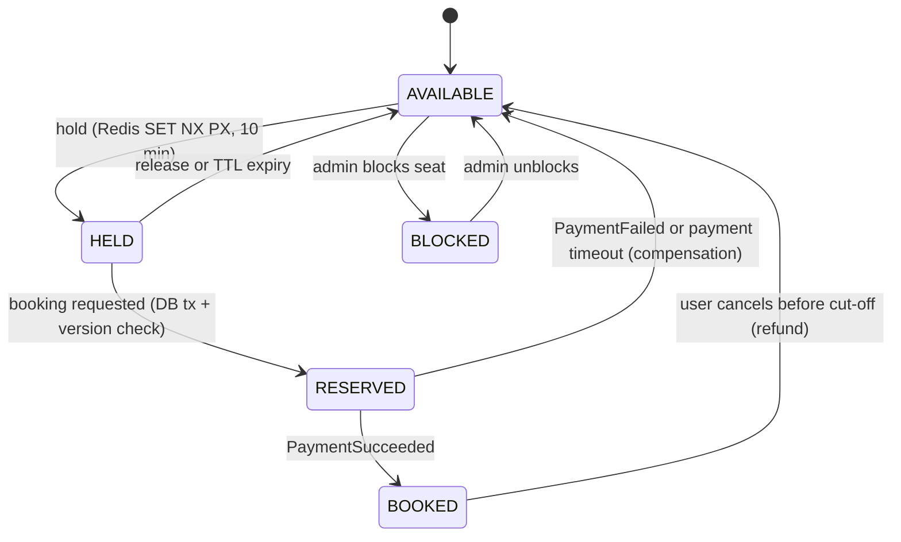
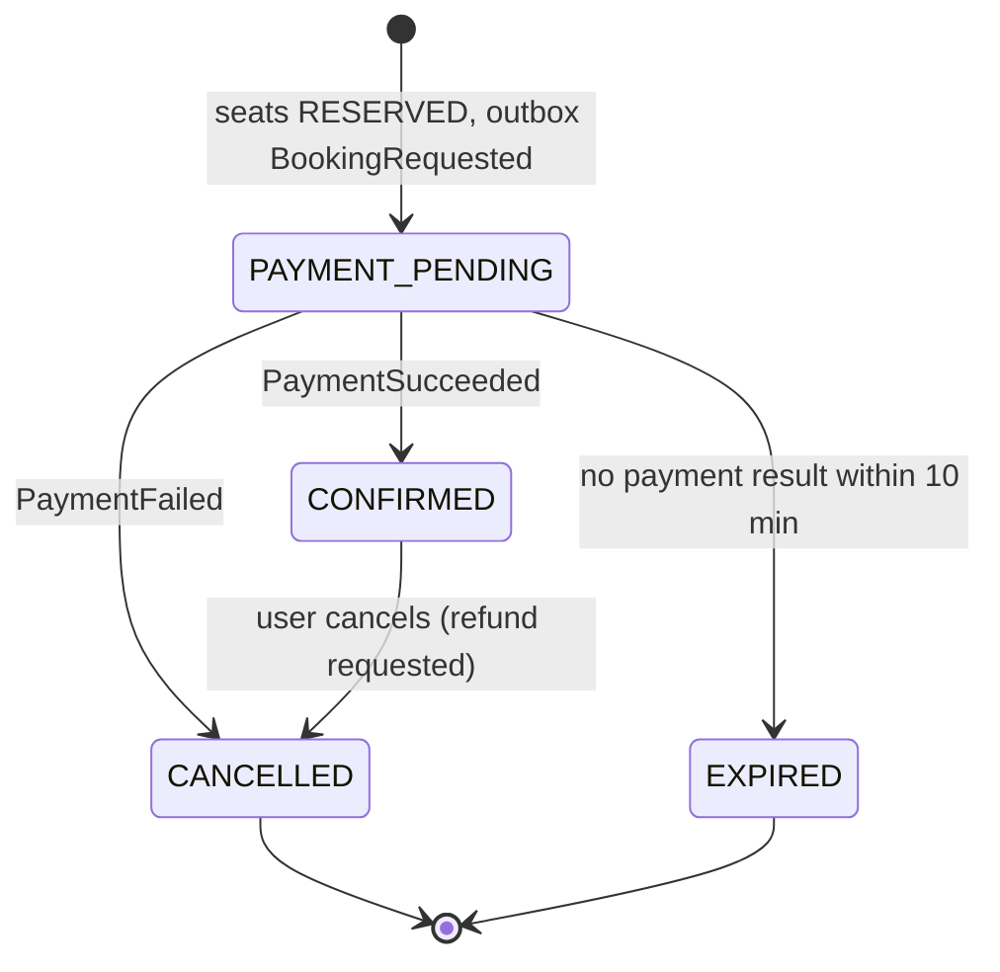
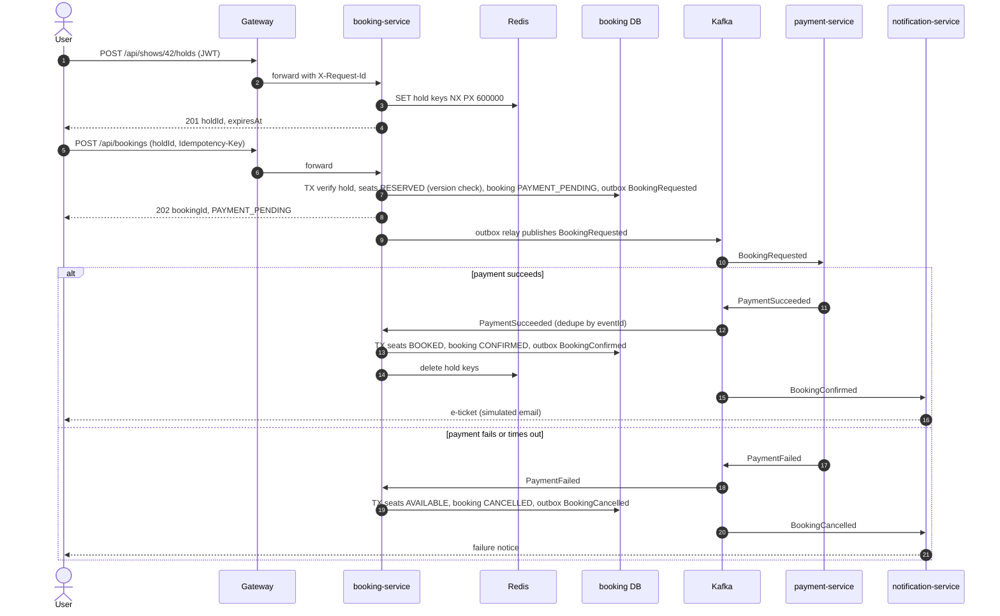

# 🎟️ TicketVerse — Project Specification (Java track capstone)

> **One-liner:** an AI-powered movie & event ticket-booking platform that **never double-books a seat**, survives partial failures, and runs on Kubernetes/Azure — built by you, week by week, from W11 to W26.

Repo: **`ticketverse`** · Stack: Java 25 · Spring Boot 4.1.x (or newest stable) · PostgreSQL 18 · Redis 8 · Kafka 4.x (KRaft) · Keycloak · Docker · Kubernetes + Gateway API · GitHub Actions · Azure · Spring AI 2.0.x
Why this project: it maps directly to the classic **LLD "BookMyShow"** and **HLD "Ticketmaster"** interview questions, and it forces real concurrency, consistency and failure-handling decisions.

---

## 1. Vision

Users browse events by city, pick a show, see a live seat map, **hold** seats for 10 minutes, pay, and get a confirmation — even when thousands try to book the same blockbuster show. Admins schedule shows; support staff look up bookings; an AI assistant ("Ask TicketVerse") answers policy questions and helps users find and hold seats. Every design choice is documented as an ADR so you can defend it in interviews.

## 2. Personas

| Persona | Goal | Key journeys |
|---|---|---|
| **Riya — moviegoer** (26, Pune, mobile-first) | Book 2 good seats fast, no surprises | Browse → seat map → hold → pay → e-ticket; view/cancel own bookings |
| **Arjun — venue admin** | Keep the schedule correct | Create events/shows, set prices, block broken seats |
| **Meera — support agent** | Resolve "I paid but no ticket" calls | Look up booking + payment status by id (read-only) |
| **You — on-call engineer** | Keep it fast, safe and observable | Dashboards, traces, runbooks, chaos tests, rollbacks |
| **Assistant user** | Ask in natural language (English/Hinglish) | "Kal shaam Pune mein 2 seats for Dune?" → options → confirm → hold |

## 3. Features by version (mapped to weeks)

| Version (git tag) | Weeks | Scope |
|---|---|---|
| **v0** (`v0.1.0`) | W11 | Spring Boot monolith: catalog APIs (events, venues, shows), Postgres via Docker Compose, record DTOs + Bean Validation, RFC 9457 errors, header-based API versioning, OpenAPI, AOP timing, `@WebMvcTest` slices |
| v0.x (internal) | W12–W13 | JPA/Hibernate data model + Flyway; N+1 fixed; Testcontainers. Seat **holds in Redis** (SET NX PX), booking with optimistic/pessimistic locking, Redis cache-aside, 100-thread no-double-booking test |
| **v1** (`v1.0.0`) — Boss S3 | W14 | Spring Security: Keycloak OIDC, JWT resource server, roles (USER/ADMIN/SUPPORT), ownership checks, CORS; Mockito + Testcontainers; JaCoCo ≥ 70 % |
| **v2** (`v2.0.0`) | W15–W16 | Split into **gateway + catalog + booking + payment-mock + notification**; DB per service; HTTP service clients with timeouts; idempotency keys; Resilience4j (retry, circuit breaker, rate limiter, bulkhead); Micrometer → Prometheus/Grafana; OpenTelemetry → Jaeger; JSON logs; chaos report |
| **v3** (`v3.0.0`, `v3.1.0` — Boss S4) | W17–W19 | Kafka events, **transactional outbox**, idempotent consumers, retry topics + DLT, **choreographed booking saga** with compensation; optimized non-root images, Trivy + SBOM, GHCR; whole system via one `docker compose up` |
| **v4** (`v4.0.0`) | W20–W22 | Kubernetes manifests → **Helm chart**; **Gateway API** (Envoy Gateway) entry; probes, HPA, StatefulSet, CronJob; GitHub Actions CI/CD (matrix, Testcontainers, CodeQL, Dependabot, SonarQube Cloud, ephemeral kind deploy, OIDC to Azure) |
| **v5** (`v5.0.0`) — Boss S5 | W23 | Live on **Azure** (AKS or Container Apps): PostgreSQL Flexible Server, Azure Managed Redis, Event Hubs Kafka endpoint (or in-cluster Kafka), Key Vault + managed identity/Workload ID, Application Insights via OpenTelemetry, budgets + teardown script |
| **v6** (`v6.0.0`) | W24 | **Ask TicketVerse**: `ai-assistant` service with Spring AI ChatClient, structured output, chat memory, guarded tool calling into catalog/booking, RAG over policies (PgVectorStore), MCP server |
| **v7** (`v7.0.0`) | W25 | k6 load tests, JFR/async-profiler fixes, virtual threads + pool tuning, OWASP API Top 10 audit, graceful shutdown, C4 diagrams, ADRs, demo video, polished README |

## 4. Domain model



| Entity (owner) | Key fields | Notes / invariants |
|---|---|---|
| `Venue` (catalog) | id, name, city, address, timezone | — |
| `Screen` (catalog) | id, venue_id, name, screen_type (2D/3D/IMAX), seat_count | — |
| `Seat` (catalog) | id, screen_id, row_label, number, category (CLASSIC/PRIME/RECLINER), accessible | unique (screen_id, row_label, number) |
| `Event` (catalog) | id, title, type (MOVIE/CONCERT/STANDUP), language, duration_min, certificate, genres, status | — |
| `Show` (catalog) | id, event_id, screen_id, starts_at (UTC), ends_at, base_price, status (SCHEDULED/OPEN/CLOSED/CANCELLED) | no overlapping shows on one screen |
| `ShowSeat` (booking — inventory) | id, show_id, seat_id, price, status (AVAILABLE/RESERVED/BOOKED/BLOCKED), booking_id, **version** | unique (show_id, seat_id); `@Version` for optimistic locking |
| Seat hold (booking — Redis) | key `hold:{showId}:{seatId}` → `{userId, holdId}`, TTL 10 min; `holdset:{holdId}` → seat ids | release only by owner (Lua compare-and-delete) |
| `Booking` (booking) | id, user_id (JWT `sub`), show_id, status, total_amount, currency (INR), idempotency_key, created_at, confirmed_at, version | aggregate root; owns its seats |
| `BookingSeat` (booking) | booking_id, show_id, seat_id, price | **UNIQUE (show_id, seat_id)** among live bookings = last line of defence against double booking |
| `Payment` (payment) | id, booking_id, amount, status (INITIATED/SUCCEEDED/FAILED/REFUNDED), provider_ref, idempotency_key | one successful payment per booking |
| `Notification` (notification) | id, user_id, booking_id, channel (EMAIL/SMS), template, status, sent_at | simulated sending |
| `OutboxEvent` (every producer) | id (eventId), aggregate_type, aggregate_id, event_type, payload (jsonb), created_at, published_at | written in the same transaction as the state change |
| `ProcessedEvent` (every consumer) | event_id, consumer, processed_at | dedupe = idempotent consumer |
| `IdempotencyKey` (booking) | key, user_id, request_hash, response_status, response_body, expires_at (24 h) | replay returns the original response |
| `PolicyChunk` (ai-assistant, pgvector) | id, content, metadata (source, section), embedding | RAG source with citations |

Users live in **Keycloak** (realm `ticketverse`, roles USER/ADMIN/SUPPORT); services store only the JWT `sub`.

## 5. Service boundaries (from v2)

| Service | Bounded context | Owns data | Sync API (via gateway) | Publishes | Consumes |
|---|---|---|---|---|---|
| `gateway` | Edge | — | routes, JWT validation, rate limits, `X-Request-Id`, CORS | — | — |
| `catalog-service` | Catalog | venues, screens, seats, events, shows (`catalog_db`) | events, venues, shows, seat layouts | `catalog.shows.v1` | — |
| `booking-service` | Booking (inventory + holds + bookings) | show_seat, bookings, outbox, idempotency (`booking_db`, Redis) | seat availability, holds, bookings | `booking.events.v1` | `payment.events.v1`, `catalog.shows.v1` |
| `payment-service` (mock) | Payment | payments (`payment_db`) | payment status (SUPPORT), chaos switch (local only) | `payment.events.v1` | `booking.events.v1` |
| `notification-service` | Notification | notifications | — | — | `booking.events.v1` |
| `ai-assistant` (v6) | Assistant | chat memory, policy vectors (pgvector) | `/api/assistant/**`, MCP endpoint | — | (calls catalog/booking over HTTP with the user's token) |
| Keycloak | Identity | users, roles, clients | OIDC endpoints | — | — |

Rules: no shared database; booking keeps the inventory it needs (built from `ShowScheduled` events or a catalog call); public URLs do not change when the monolith is split (the gateway routes by path). On Kubernetes, the Gateway API (Envoy Gateway) is the north–south entry and forwards `/api/**` to the Spring Cloud Gateway service.

## 6. REST API sketch

All errors are [RFC 9457 ProblemDetail](https://www.rfc-editor.org/rfc/rfc9457.html) with `type, title, status, detail, instance, errorCode, traceId`. Version via header `X-API-Version` (Spring Framework 7 API versioning). Pagination: `page, size (max 50), sort`.

| Method & path | Auth | Purpose / notes |
|---|---|---|
| `GET /api/events?city=&type=&date=&page=&size=&sort=` | public | Browse events (cached) |
| `GET /api/events/{eventId}` | public | Event details (v2 adds extra fields) |
| `POST /api/events` · `PUT /api/events/{id}` · `DELETE /api/events/{id}` | ADMIN | Manage events → 201 + `Location` / 200 / 204 |
| `GET /api/venues?city=` | public | Venues |
| `GET /api/events/{eventId}/shows?city=&date=` | public | Shows for an event |
| `GET /api/shows/{showId}/seats` | public | Seat map with AVAILABLE/HELD/RESERVED/BOOKED |
| `POST /api/shows/{showId}/holds` `{seatIds[]}` | USER | All-or-nothing hold, 10-min TTL → 201 `{holdId, expiresAt}`; 409 if any seat taken; 429 if rate-limited |
| `DELETE /api/holds/{holdId}` | USER (owner) | Release hold → 204 |
| `POST /api/bookings` `{holdId}` + `Idempotency-Key` | USER (owner of hold) | v1: 201 CONFIRMED (sync); v3+: 202 `{bookingId, status: PAYMENT_PENDING}` (saga) |
| `GET /api/bookings/{bookingId}` | owner / SUPPORT / ADMIN | 404 for non-owners (no ID probing) |
| `GET /api/bookings?page=` | USER (own) / SUPPORT, ADMIN (filter by `userId`) | List bookings |
| `POST /api/bookings/{bookingId}/cancel` | owner | Before cut-off → 202, refund via events |
| `GET /api/payments/{bookingId}` | SUPPORT | Payment status |
| `POST /api/assistant/chat` · `GET /api/assistant/chat/stream` | USER | AI assistant (v6) |
| `/mcp` | token | MCP tools: `searchShows`, `seatAvailability`, `getMyBookings` (read-only) |
| `/actuator/health/{liveness,readiness}`, `/actuator/prometheus` | internal | Probes and metrics (not exposed publicly) |

## 7. Kafka topics & event schemas (from v3)

| Topic | Key | Producer | Consumers | Event types | Partitions | Cleanup |
|---|---|---|---|---|---|---|
| `booking.events.v1` | bookingId | booking (outbox) | payment, notification | BookingRequested, BookingConfirmed, BookingCancelled, BookingExpired | 6 | delete, 7 days |
| `payment.events.v1` | bookingId | payment (outbox) | booking | PaymentSucceeded, PaymentFailed, PaymentRefunded | 6 | delete, 7 days |
| `catalog.shows.v1` | showId | catalog (outbox) | booking | ShowScheduled, ShowUpdated, ShowCancelled | 3 | **compact** (latest state per show) |
| `*-retry-*`, `*-dlt` | same | Spring Kafka | DLT listener | failed records + exception headers | same as source | delete, 14 days |

Key = bookingId keeps every event of one booking **in order** on one partition. Trace context travels in Kafka headers. Event envelope:

```json
{
  "eventId": "0b8f6c1e-5a0e-4c51-9a4e-2f0d7e1c9a10",
  "eventType": "BookingRequested",
  "eventVersion": 1,
  "occurredAt": "2027-02-24T14:05:11Z",
  "aggregateType": "Booking",
  "aggregateId": "bk_7f3a",
  "payload": {
    "bookingId": "bk_7f3a",
    "userId": "kc-sub-123",
    "showId": 42,
    "seats": [{ "seatId": 1001, "price": 320.00 }, { "seatId": 1002, "price": 320.00 }],
    "amount": 640.00,
    "currency": "INR"
  }
}
```
Evolution rule: only add optional fields within a version; breaking change → new event version (`eventVersion: 2`) and a new topic if needed.

## 8. State machines

**Seat (per show)** — HELD lives in Redis; the other states live in `show_seat`:



**Booking**:


Illegal transitions throw and are unit-tested (enum-based state machine).

## 9. Booking saga (choreography + transactional outbox)


Background jobs: outbox relay (every 500 ms, `FOR UPDATE SKIP LOCKED`), payment-timeout expirer (every minute), expired-hold reconciler (CronJob in v4). References: [Saga pattern](https://microservices.io/patterns/data/saga.html) · [Transactional outbox](https://microservices.io/patterns/data/transactional-outbox.html).

## 10. Non-functional requirements

| Area | Requirement | Verified by |
|---|---|---|
| **No double booking** | A seat is sold at most once per show, under any concurrency | DB `UNIQUE(show_id, seat_id)` + `@Version` on `show_seat` + Redis hold ownership; 100-thread test (W13), saga tests (W18) |
| **Latency** (local, 20 req/s) | p95: browse < 200 ms · hold < 300 ms · booking request (202) < 400 ms · confirmation end-to-end < 3 s | k6 thresholds (W25) |
| **Idempotency** | Retried `POST /api/bookings` never creates a second booking; duplicate events have no effect | `Idempotency-Key` table (24 h), `processed_event` dedupe, payment idempotency key |
| **Resilience** | Payment outage must not take down browsing or holds | Timeouts on every call (≤ 2 s), retries only for idempotent ops (backoff + jitter), circuit breaker, bulkhead, rate limits; chaos report (W16) |
| **Security** | OAuth2/OIDC everywhere, least privilege, no BOLA | Keycloak JWT at gateway + services, role and ownership checks, OWASP API Top 10 audit (W25), secrets in Key Vault (W23) |
| **Observability** | Any booking traceable end to end in < 2 minutes | RED + business metrics, OpenTelemetry traces across HTTP and Kafka, JSON logs with `traceId`, Grafana dashboard, App Insights (cloud) |
| **Availability** | Rolling deploys with zero failed requests; target 99.5 % for the demo | Readiness/liveness probes, graceful shutdown, HPA (W20–W25) |
| **Data** | Versioned schemas; minimal PII (email only); retention: holds 10 min, idempotency keys 24 h, Kafka 7 days | Flyway per service; PITR backups on Azure PostgreSQL |
| **Cost** | Cloud spend within the monthly budget; nothing left running after demos | Budget alerts + `teardown.sh` (W23) |
| **Quality** | ≥ 70 % line coverage; no CRITICAL vulnerabilities; green pipeline on `main` | JaCoCo gate, Trivy, CodeQL, SonarQube Cloud (W14, W19, W22) |

## 11. Repository structure

```text
ticketverse/
├─ pom.xml                      # parent: Spring Boot 4.1.x BOM, Java 25, JaCoCo, plugin management
├─ mvnw, .mvn/                  # Maven Wrapper (Maven 3.9.x / 3.10.x)
├─ common/                      # event contracts (records), ProblemDetail types — no business logic
├─ gateway/                     # Spring Cloud Gateway
├─ catalog-service/             # src/main/java/.../catalog/{api,application,domain,infrastructure}
├─ booking-service/             # inventory, holds (Redis), bookings, outbox, saga handlers
├─ payment-service/             # mock payments with chaos switch (local only)
├─ notification-service/
├─ ai-assistant/                # Spring AI (v6)
├─ compose.yaml, .env.example   # profiles: infra, apps, obs
├─ k8s/                         # raw manifests (W20)
├─ charts/ticketverse/          # Helm umbrella chart (W21)
├─ infra/                       # deploy.sh, teardown.sh, Bicep (W23)
├─ perf/booking-flow.js         # k6 (W25)
├─ docs/                        # adr/, events.md, auth.md, RUNBOOK.md, SECURITY.md, PERFORMANCE.md, CHAOS_REPORT.md, kql.md, diagrams/
└─ .github/                     # workflows/ci.yml, images.yml, cd.yml · dependabot.yml
```

## 12. Milestones

| Week | Version | Acceptance criteria | XP |
|---|---|---|---|
| W11 | v0 · `v0.1.0` | Fresh clone runs with one command (Postgres auto-started); catalog CRUD; ProblemDetail errors; v1/v2 via header; Swagger UI; 6 slice tests green | +200 on ship |
| W14 | v1 · `v1.0.0` **(Boss S3)** | Keycloak login → browse → hold → book → own booking visible, other user gets 404; JaCoCo ≥ 70 %; release notes + 3-min demo | +200 (+300 boss) |
| W16 | v2 · `v2.0.0` | 5 services + gateway; idempotent bookings; circuit breaker visible in actuator; Grafana dashboard + Jaeger trace; chaos report with p95 ≤ 2× baseline | +200 |
| W18 | v3 · `v3.0.0` | Happy + failure sagas pass in automated e2e tests; no lost events when Kafka restarts; poison message in DLT | +200 |
| W19 | `v3.1.0` **(Boss S4)** | `docker compose up` from clean state → all healthy → saga demo inside 60 min; images on GHCR, no unexplained CRITICAL CVEs | +300 boss |
| W22 | v4 · `v4.0.0` | Helm install on fresh kind via Gateway API; PR → CI → images → ephemeral deploy + smoke test all green; OIDC login to Azure | +200 |
| W23 | v5 · `v5.0.0` **(Boss S5)** | Public HTTPS URL; managed data services; zero secrets in Git/images; App Insights trace; teardown verified | +200 (+300 boss) |
| W24 | v6 · `v6.0.0` | 6-turn assistant demo: find show, RAG answer with citation, confirmed hold, booking, "what did I book?"; no write without confirmation | +200 |
| W25 | v7 · `v7.0.0` | PERFORMANCE.md (baseline vs tuned), SECURITY.md audit with fixes, zero-error rolling restart, C4 + ADRs, 5-min demo video | +200 |

## 13. Tech stack (versions as of Oct 2026 — let the Boot BOM manage library versions)

| Layer | Choice |
|---|---|
| Language/runtime | Java 25 (Temurin), virtual threads where they help |
| Framework | Spring Boot 4.1.x (or newest stable) → Spring Framework 7.0.x, Spring Security 7.1.x, Hibernate ORM 7.4, Jackson 3.x, Micrometer 1.17 |
| Data | PostgreSQL 18 + Flyway 12 · Redis 8 (Azure Managed Redis in cloud) |
| Messaging | Kafka 4.x KRaft (clients 4.2.x via Boot), Spring for Apache Kafka 4.1.x · Event Hubs Kafka endpoint (cloud option) |
| Edge & resilience | Spring Cloud Gateway · Resilience4j 2.4.x · HTTP service clients (`@HttpExchange`) |
| Security | Keycloak (OIDC), OAuth2 resource server (JWT) |
| Testing | JUnit 6 (Jupiter — same API as JUnit 5) · Mockito 5.2x · AssertJ · Testcontainers 2.0.x · JaCoCo |
| Observability | Micrometer + Prometheus + Grafana · OpenTelemetry → Jaeger v2 · Application Insights (cloud) |
| Delivery | Docker (multi-stage, non-root) · Kubernetes + Gateway API (Envoy Gateway) · Helm 4 · GitHub Actions · GHCR/ACR · Azure (AKS or Container Apps) |
| AI | Spring AI 2.0.x (ChatClient, tools, PgVectorStore, MCP) · LangChain4j 1.x (comparison only) |

## 14. Definition of Done (every feature)

- [ ] Tests: unit + slice/integration (Testcontainers) green; concurrency tests run 5× without flakes
- [ ] Errors return ProblemDetail; inputs validated; authz rule written and tested
- [ ] Timeouts on outbound calls; idempotency considered
- [ ] Metrics/traces/logs let you debug it; dashboards updated if needed
- [ ] README/ADR/events doc updated; commit message explains *why*

## 15. Resume bullets you'll earn (fill in your real numbers)

- Built **TicketVerse**, an event-driven ticket-booking platform (Java 25, Spring Boot 4, Kafka, PostgreSQL, Redis) with 5 microservices behind an API gateway, deployed to **Azure** through a GitHub Actions pipeline using OIDC (no stored cloud secrets).
- Guaranteed **zero double bookings under 100 concurrent requests** by combining Redis seat holds (SET NX PX), optimistic locking (`@Version`) and database unique constraints; proven by automated concurrency tests.
- Implemented a **choreographed booking saga** with transactional outbox, idempotent consumers, retry topics and DLT — no lost or duplicated events across broker restarts.
- Reduced **p95 booking latency from __ ms to __ ms (__ %)** by fixing N+1 queries, adding composite indexes and tuning connection pools/virtual threads; validated with k6, JFR and async-profiler.
- Added resilience (circuit breaker, retries with jitter, bulkheads, rate limits) and observability (Prometheus/Grafana, OpenTelemetry/Jaeger, Application Insights); chaos test kept p95 within 2× during a payment outage.
- Secured APIs with **OAuth2/OIDC (Keycloak)**, JWT resource servers and ownership checks; audited against the OWASP API Security Top 10 and fixed __ findings.
- Shipped **"Ask TicketVerse"**, a Spring AI assistant with tool calling into booking APIs, RAG over policy docs (pgvector) and an MCP server, with confirmation guardrails for write actions.
- Containerized services with multi-stage non-root images (__ % smaller), packaged a Helm chart with **Gateway API** routing, and enforced quality gates (Testcontainers, JaCoCo ≥ 70 %, CodeQL, Trivy, SonarQube Cloud).
